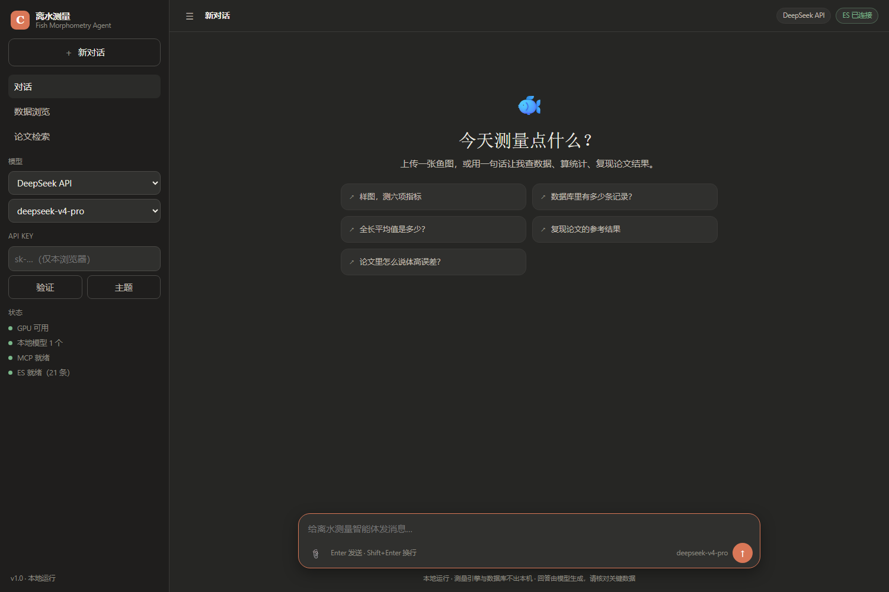
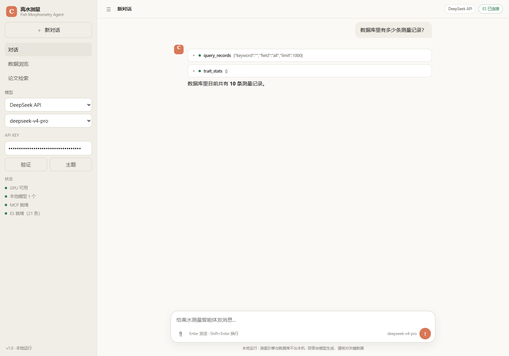
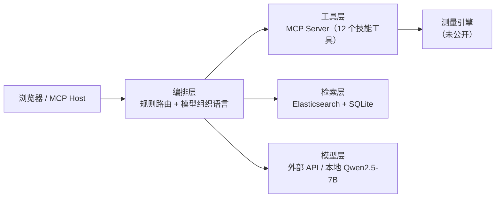

# LTM-Agent

> 智慧渔业「离体测量」智能体系统 · 项目介绍与演示

  
  

**一句话**：把鱼体性状测量引擎封装为 **12 个 MCP 技能工具**，配合「规则路由 + 模型组织」的编排与 Elasticsearch 检索，做成能用自然语言完成「测图 → 入库 → 统计 → 查询」的智能体系统。

  
  
  
  
  
  

---

## 它能做什么

| 能力 | 说明 |
|---|---|
| 自然语言测量 | 「测这张图 → 入库 → 查某品种均值 → 导出」多步任务一条指令完成 |
| 工具化 | 12 个标准化 MCP 技能工具（测量 / 批量 / 查询 / 统计 / 复现 / 标定 / 导出 / 图层 / 视频帧），可被任意 MCP Host 挂载 |
| 批量管理 | 多图 / 文件夹批量测量逐条入库；按品种、编号、批次筛选与增删改查；六项指标聚合统计；CSV / Excel 导出 |
| 检索与溯源 | SQLite 负责写入（事务与追溯），Elasticsearch 负责查询与检索；回答中的数字与页码可回溯到来源 |
| 双模型 | 外部大模型 API 与本地 Qwen2.5-7B 双通道可切，敏感场景数据不出域 |
| 可视化 | 图片 / 视频逐帧 / 摄像头抓拍，多层图层叠加，浅色 / 深色主题 |

## 系统架构（概要）

## 设计要点

1. **工具化优先**：把桌面软件里的测量能力拆成 12 个业务动作级别的 MCP 工具，默认只读、写操作带破坏性提示；
2. **小模型可用性**：直接做 function calling 存在参数中文化、调完不收口、编造出处三类问题，采用「规则路由 + 模型组织语言」的混合编排解决；
3. **读写分离**：写入走 SQLite（事务与追溯），检索聚合走 Elasticsearch，一致性通过索引重建与逐项比对保证；
4. **数据不出域**：外部模型模式只发送问题与工具结果摘要，代码、图片、数据、模型全程本地。

## 验证结果（摘要）

| 验证项 | 结果 |
|---|---|
| 12 工具 × 15 用例，三种环境 | 均 15/15 |
| 9 张标准样图复测 vs 历史记录 | 回归一致（验证封装与配置正确，非测量精度） |
| 单张测量（CPU） | 0.5–0.9 s |

---

## 开源范围说明

本仓库仅提供**项目介绍与界面演示截图**；测量引擎、ONNX 模型、原始数据与核心实现代码**未公开**。如对方案细节感兴趣，可通过 [Issues](https://github.com/bin-223/LTM-Agent/issues) 交流。

## 许可

[LICENSE](LICENSE) · MIT
